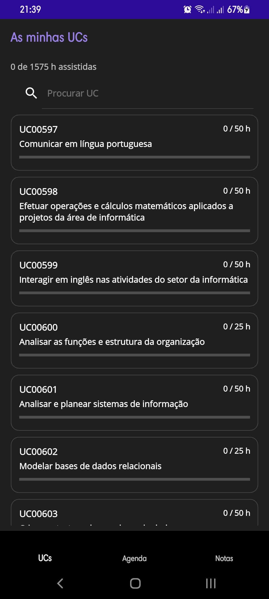
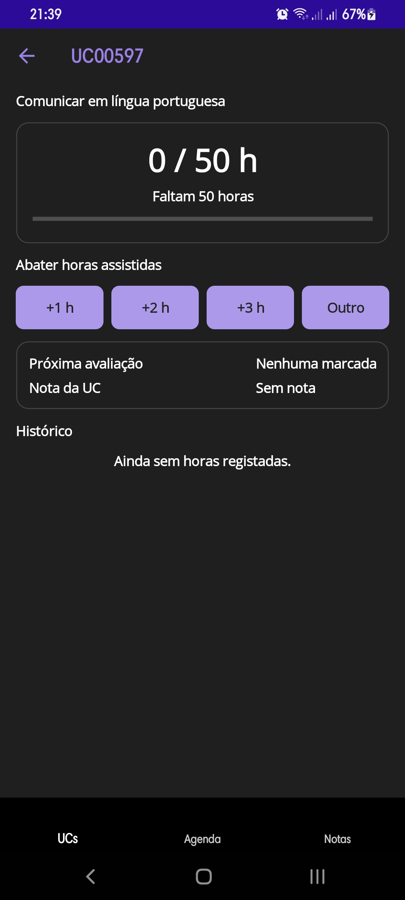
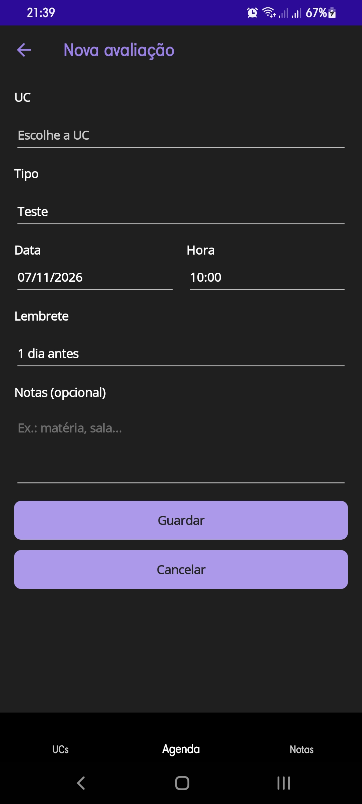
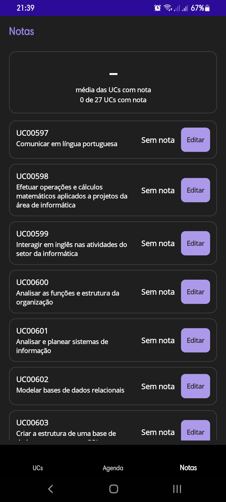

# TPSI Horas

App multiplataforma em **.NET MAUI** (Android e Windows) para acompanhar as UCs do curso CET em Tecnologias e Programação de Sistemas de Informação (TPSI): horas assistidas, avaliações, lembretes e notas.

Projeto de código aberto. Os dados são armazenados exclusivamente de forma local no dispositivo.

  
  
  
  

---

## 🚀 Funcionalidades
- **27 UCs do curso:** Com barra de progresso e pesquisa rápida.
- **Horas assistidas:** Abater horas (`+1`, `+2`, `+3` ou personalizado) com histórico completo.
- **Avaliações e Notas:** Gestão de testes/trabalhos com notas de 0 a 20 e cálculo de média.
- **Lembretes locais:** Notificações automáticas antes de cada teste ou trabalho.

---

## 📱 Instalar no Android
1. Descarregue o ficheiro `.apk` mais recente na secção de [Releases](https://github.com/Reverson75/TPSI-HORAS/releases).
2. Instale no telemóvel (poderá ser necessário permitir fontes desconhecidas).

---

## 💻 Compilar e Publicar (Para Desenvolvedores)

### Requisitos
- Visual Studio 2026 com carga de trabalho **.NET MAUI** e **.NET 10 SDK**.

### Publicar APK Assinado (PowerShell)
` ` `powershell
cd TPSI-HORAS
$s = Read-Host "Password da keystore" -AsSecureString
$env:ANDROID_PASS = (New-Object System.Net.NetworkCredential("", $s)).Password
dotnet publish -f net10.0-android -c Release -p:AndroidPackageFormat=apk -p:AndroidKeyStore=true -p:AndroidSigningKeyStore=F:\chaves\tpsi-horas.keystore -p:AndroidSigningKeyAlias=tpsi-horas -p:AndroidSigningKeyPass=env:ANDROID_PASS -p:AndroidSigningStorePass=env:ANDROID_PASS
Remove-Item Env:ANDROID_PASS
` ` `

---

## 🔒 Privacidade
- **100% Offline:** Sem servidores externos ou recolha de dados.
- A versão Release **não** solicita permissões de internet.

---

## 📄 Licença
Distribuído sob a licença **MIT**. Veja o ficheiro [LICENSE](LICENSE) para mais detalhes.

Desenvolvido por **Reverson** no âmbito do CET em TPSI.
